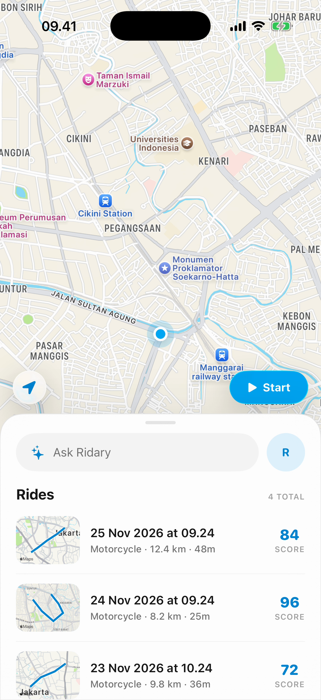
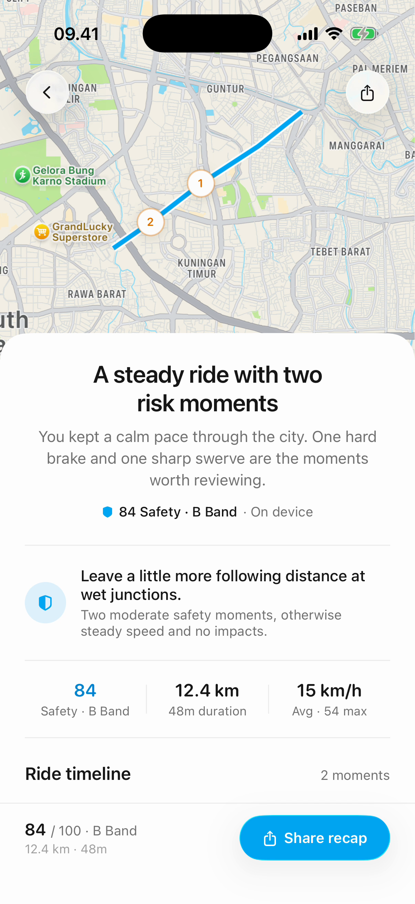
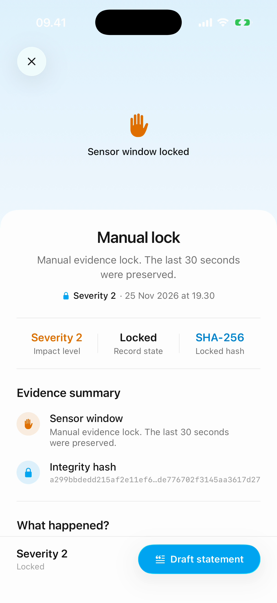
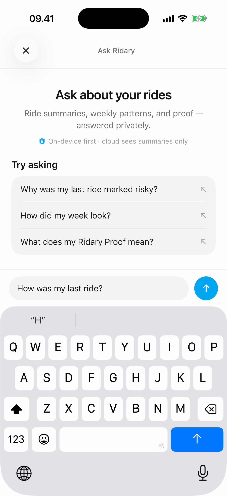
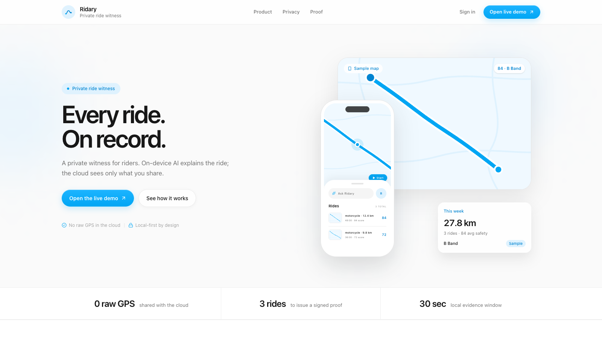
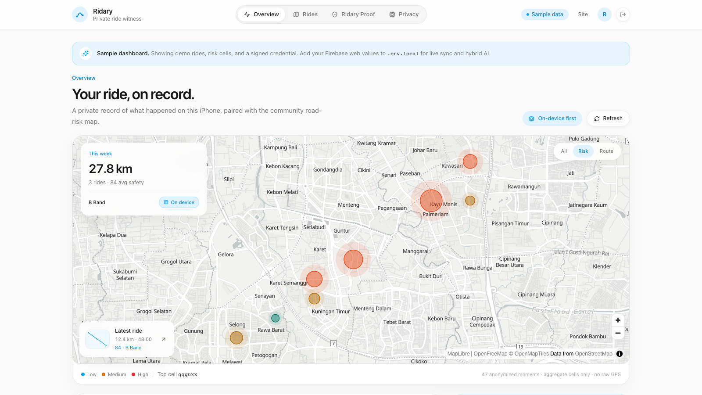
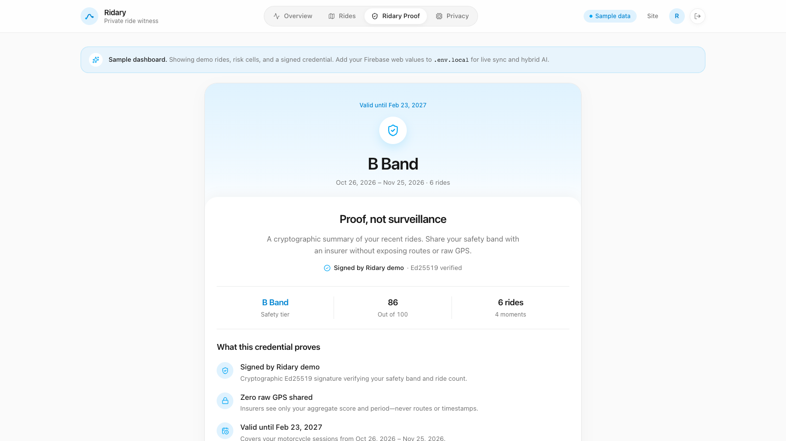
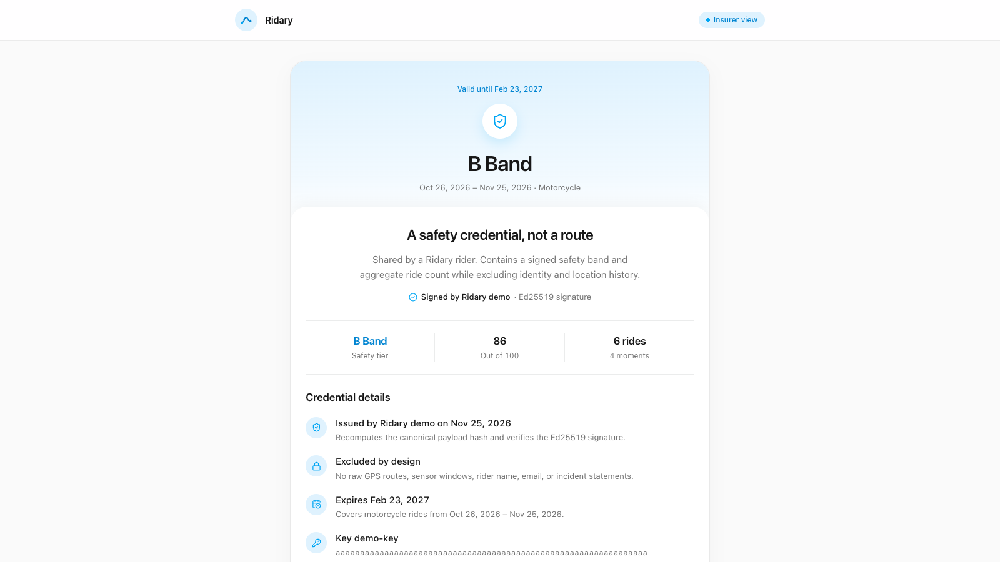

# Ridary

> Every ride, on record. Private at the edge. Collective in the cloud.

Ridary is a private ride witness and a signed safety credential. It turns an
ordinary iPhone ride into a local, useful record of what happened — then lets
the rider share only the smallest aggregate needed to build a community road-risk
map or prove a safety score to an insurer.

Built for **#BuildHybridAI 2026** with **Firebase AI Logic hybrid inference**:
Apple Foundation Models on iOS, Gemini Nano in Chrome when available, and
Gemini cloud fallback for the jobs that need it.

## Product tour

| iOS · Home | iOS · Ride recap | iOS · Evidence lock | iOS · Ask Ridary |
| :---: | :---: | :---: | :---: |
|  |  |  |  |

| Web · Landing | Web · Risk dashboard | Web · Ridary Proof | Web · Insurer view |
| :---: | :---: | :---: | :---: |
|  |  |  |  |

All screenshots and demo flows use sample data.

## Live demo

- Web dashboard: <https://ridary-demo.web.app>
- Open the dashboard and choose **Explore the demo dashboard** (no account
  needed).
- On iOS, choose **Explore local demo** from the sign-in screen.
- The demo is seeded with sample rides and one signed credential.

Never put real ride data or production credentials in the public demo.

## Why this project

Most ride apps ask riders to upload everything, then sell them a dashboard.
Ridary takes the opposite position:

- The full-resolution raw route, IMU samples, and incident evidence stay on the
  phone.
- A rider can separately opt in to a capped route preview for the dashboard;
  that is not the full raw GPS trace.
- On-device AI explains the ride and drafts sensitive incident notes while
  offline.
- Cloud AI only sees derived event points, summaries, and a coarse geohash.
- The rider can share a signed score with an insurer without handing over a
  route, an identity, or a sensor trace.

The product is deliberately not another Strava, dashcam, or fleet telematics
tool. It is a **rider-owned ride witness** with a **privacy-preserving
credential**.

## What it does

### iOS app

- Starts an explicit ride session; the phone can stay in a pocket.
- Records GPS, speed, altitude, accelerometer, and gyroscope in the background
  during the session.
- Runs a deterministic event detector for hard braking, sharp swerves, impacts,
  crash candidates, and long stops.
- On-device AI (`PREFER_ON_DEVICE`) produces a private ride snapshot: headline,
  plain-language summary, risk moments, safety score, and a coaching tip.
- `ONLY_ON_DEVICE` incident interview drafts a factual statement and evidence
  checklist. Sensitive evidence is never silently sent to the cloud.
- “Lock last 30 seconds” creates a protected local evidence packet with a
  SHA-256 integrity hash and a PDF export.
- Sends derived summaries and event points to Firestore when the rider enables
  sharing; a separate opt-in capped route preview can be included.
- Issues a Ridary Proof credential and a time-limited insurer link.

### Web dashboard

- Sign in with the same Firebase account as the phone (or use the demo).
- View recent rides, a community risk map, and the latest private snapshot.
- Run an on-device-first review of a ride (Chrome Nano when available, Gemini
  cloud fallback), with visible source badges.
- Generate a cloud community insight from aggregate risk cells, with visible
  provenance.
- Verify a credential signature and create an insurer view.
- A public `/insurer/:token` page shows only the signed credential; it never
  exposes the rider's raw route or identity.

### Cloud Functions

- Aggregates anonymized event points into Firestore `riskCells`.
- Issues an Ed25519-signed credential after at least three eligible rides.
- Verifies the credential hash and signature.
- Creates a short-lived, redacted insurer view.
- Returns weekly ride/event aggregates for the client-side cloud AI call.

## Hybrid AI: the actual split

| Feature | Mode | Where it runs | Why |
|---|---|---|---|
| Ride snapshot | `PREFER_ON_DEVICE` | Apple Foundation Models / Chrome Nano, cloud fallback | Private and offline-first |
| Event interpretation | `PREFER_ON_DEVICE` | On-device, cloud fallback | Sensitive sensor windows |
| Incident interview + statement | `ONLY_ON_DEVICE` | On-device only; local rules if unavailable | Evidence stays on the phone |
| Weekly feedback | `PREFER_IN_CLOUD` | Gemini cloud, on-device fallback | Cross-ride context |
| Cross-rider risk analyst | `ONLY_IN_CLOUD` | Gemini cloud | Needs aggregates the device cannot see |
| Credential narrative (roadmap) | `ONLY_IN_CLOUD` | Gemini cloud | Issued from aggregate data |
| Insurer report (roadmap) | `PREFER_IN_CLOUD` | Gemini cloud | Final document generation |

The app shows the inference origin (`On device`, `In cloud`, `Fallback`, or
`Rules`) in the UI. The cloud does not receive the full raw GPS trace or IMU
samples; an opt-in simplified route preview is a separate consent and is never
sent to the AI.

Read [docs/hybrid-ai.md](docs/hybrid-ai.md) for the detailed reasoning and
platform limitations.

## Repository layout

```
ios/         SwiftUI iOS app (XcodeGen + SPM Firebase 12.19.3)
web/         Vite + React + TypeScript dashboard + Chrome Nano
functions/   TypeScript Firebase Functions (Node 22 runtime)
shared/      JSON contracts, prompt templates, prompt codegen
docs/        Architecture, setup, demo script, privacy model
```

## Quick start

You can explore the full UI without Firebase. The iOS app and web dashboard
detect a missing configuration and enter a clearly labelled local demo mode.

### 1. Firebase project

1. Create a Firebase project.
2. Enable **AI Logic** and choose the **Agent Platform Gemini API** (formerly
   Vertex AI). This path needs the Blaze plan; it avoids Gemini API prepay
   credit limits during the demo.
3. Enable **App Check** and enforce it for AI Logic. The clients request
   limited-use App Check tokens for AI Logic.
4. Enable **Authentication** (Email/Password and Anonymous), **Firestore**, and
   **Cloud Functions**.
5. Register an iOS app with bundle id `app.ridary.ios`.
6. Register a web app and copy its config values.

### 2. iOS

```bash
cd ios
xcodegen generate
open Ridary.xcodeproj
```

- Download `GoogleService-Info.plist` from Firebase to
  `ios/Config/GoogleService-Info.plist`. For a demo-only build, copy
  `ios/Config/GoogleService-Info.plist.example` instead; the project generates
  and runs in local demo mode without a real config.
- Run on an iPhone with **iOS 26+ and Apple Intelligence enabled** for on-device
  inference. On the simulator or a non-Apple-Intelligence device, Ridary falls
  back to cloud/rule-based output and labels it honestly.
- App Check uses the debug provider in this build. Run the app, copy the debug
  token from the Xcode console, and register it under **App Check → Apps →
  Manage debug tokens**.
- On-device inference runs only when the app is in the foreground. Background
  capture is sensor-only; the snapshot is generated when the rider opens the
  app after the ride.

See [docs/setup.md](docs/setup.md) for details.

### 3. Web dashboard

```bash
cd web
cp .env.example .env.local
# fill in the Firebase web app values and App Check site key
npm install
npm run dev
```

- Chrome Nano requires desktop Chrome 139+ and the multimodal prompt flag:
  `chrome://flags/#prompt-api-for-gemini-nano-multimodal-input`.
- If Nano is unavailable, Firebase AI Logic automatically falls back to Gemini
  via the Agent Platform Gemini API.
- Without `.env.local`, the dashboard runs with sample data and clearly labels
  every screen as demo mode.

### 4. Functions

```bash
cd functions
npm install
npm run generate:keys
# copy the output into functions/.env (local) or a secret manager (production)
npm run build
```

Deploy with Firebase CLI:

```bash
npm install -g firebase-tools
firebase login
firebase use --add
firebase deploy --only firestore:rules,firestore:indexes,functions,hosting
```

The web build must be generated first for Hosting:

```bash
npm --prefix web run build
```

For the emulator, install Java first (the Firestore emulator requires it):

```bash
firebase emulators:start
```

The AI Logic calls are client-side and are not emulated; use a real Firebase
project for hybrid inference.

## Verification

```bash
# iOS
cd ios
xcodegen generate
xcodebuild -project Ridary.xcodeproj -scheme Ridary \
  -destination 'platform=iOS Simulator,name=iPhone 17 Pro,OS=26.5' \
  -derivedDataPath /tmp/ridary-derived CODE_SIGNING_ALLOWED=NO test

# Web
npm --prefix web run lint
npm --prefix web run typecheck
npm --prefix web test
npm --prefix web run build

# Functions
npm --prefix functions run lint
npm --prefix functions run typecheck
npm --prefix functions test
npm --prefix functions run build
```

Current verification on this machine:

- iOS: 40 XCTest unit tests and 17 XCUITest flows; the demo capture flows are in
  `ios/RidaryUITests/DemoCaptureUITests.swift`.
- Web: 23 Vitest tests and 6 test files passing; ESLint, TypeScript, and
  production build are expected to be clean.
- Functions: 33 Vitest tests and 6 test files passing; ESLint, TypeScript, and
  build are expected to be clean.
- Node 24 is used for local builds; the deployed Functions runtime is Node 22.
- Run the commands above before publishing; the Home sheet UI test is
  data-dependent on simulator content.

## Demo script

The final demo cut is **2:42** (the contest maximum is 3:00). The storyboard,
voiceover guide, and capture notes live in
[docs/demo-script.md](docs/demo-script.md) and `video/`. It shows the private
ride and timer, the 30-second evidence lock, the on-device recap, Ask Ridary,
the community map, and the redacted insurer proof.

## Privacy and security

- The full raw GPS route and IMU samples are never written to Firestore. A
  separate opt-in simplified route preview (capped at 128 points) can be
  shared; it is not used as AI input.
- Firestore rules only allow a user to read/write their own ride and event
  documents; risk cells and insurer views are written by Admin only.
- Locked evidence is stored locally with file protection and a SHA-256 hash.
- Credentials are signed with Ed25519 in a Cloud Function; the private key is
  never shipped in the app.
- App Check is enforced for credential issuance and AI Logic.
- The insurer page receives a signed score, not the rider identity or route.

Read [docs/privacy-security.md](docs/privacy-security.md) for the threat model
and limits.

## Honest limitations

- iOS on-device inference is foreground-only; this is an Apple/Firebase
  limitation, not hidden.
- Apple Foundation Models require iOS 26+ and an Apple Intelligence device.
- Chrome Nano requires desktop Chrome 139+ and a model download.
- Android is not implemented yet; the data/AI contracts are Android-ready.
- The insurer integration is a credential + public view mock, not a real carrier
  contract.
- This is a personal safety record, not court-grade evidence and not legal,
  medical, or insurance advice.
- Background capture can be killed by the operating system under memory
  pressure; an interrupted session is detected and cleared on next launch.

## Roadmap

- Android capture app using the same Firebase AI Logic hybrid modes.
- iOS 27 on-device image input for incident photos.
- Live hazard alerts from cached risk cells.
- Carrier/fleet integrations and a rider-owned data cooperative.
- Battery-aware adaptive sampling and a lower-power motion profile.

See [docs/roadmap.md](docs/roadmap.md).

## License

Apache-2.0. See [LICENSE](LICENSE).
